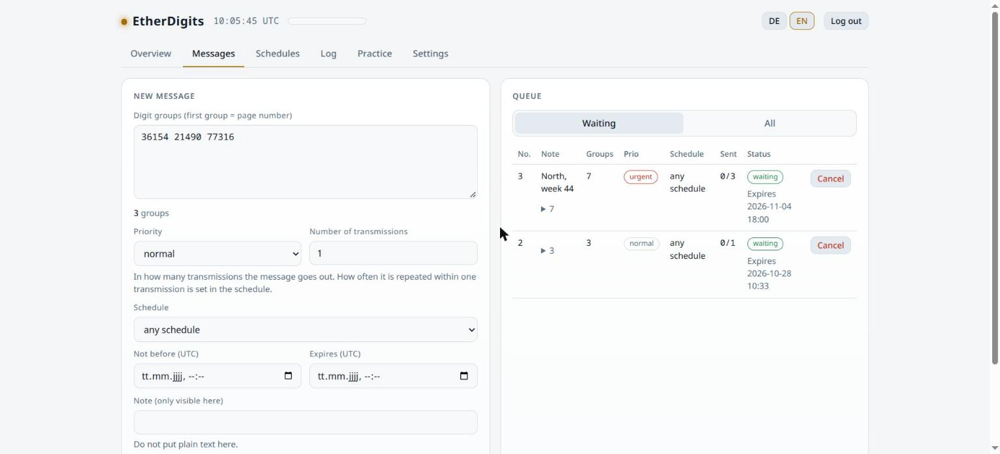
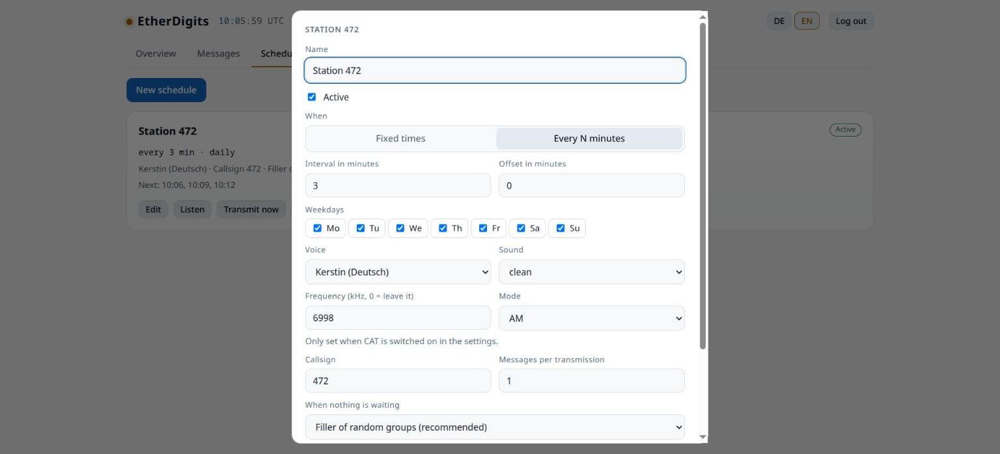
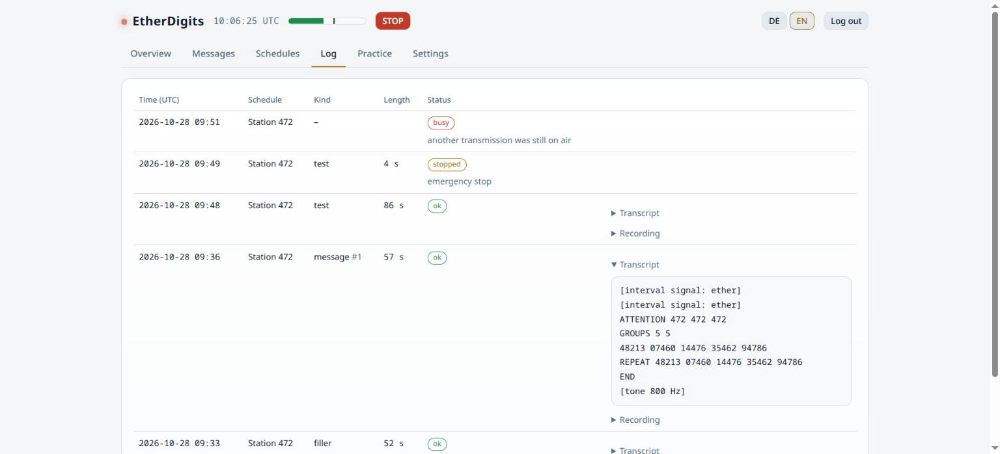
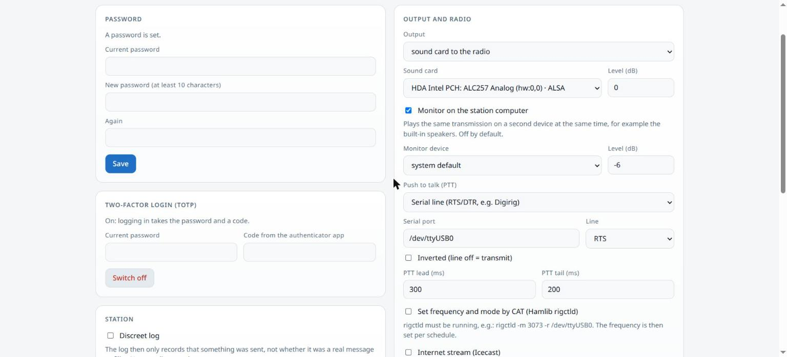
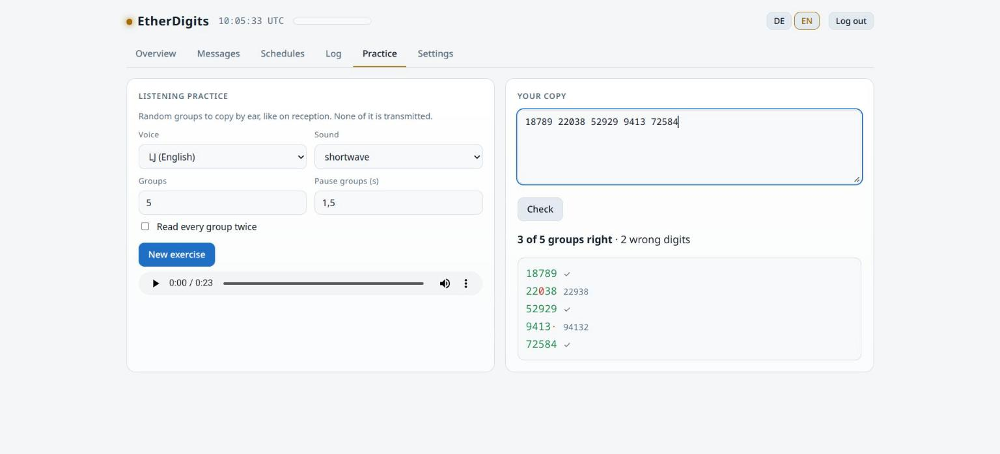
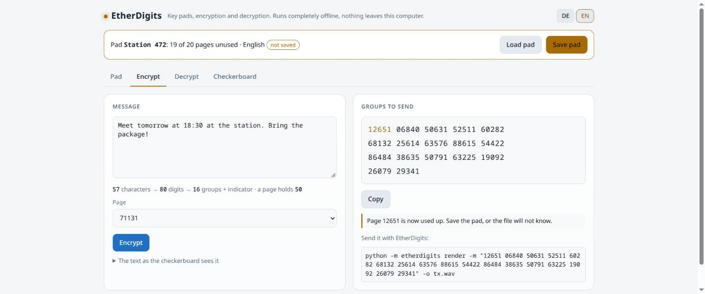

# EtherDigits

<p>
  
  <a href="https://github.com/TechnikWeber/EtherDigits/releases/latest"></a>
  <a href="https://github.com/TechnikWeber/EtherDigits/actions/workflows/tests.yml"></a>
  
  
  <a href="LICENSE"></a>
</p>

**Run your own numbers station.** EtherDigits reads out groups of digits in the
format shortwave numbers stations have used for decades: an interval signal, the
station's callsign, the number of groups, the message, a repeat, and the end.

```
[interval signal]
ATTENTION 472 472 472
GROUPS 3 3
21347 47890 11203
REPEAT 21347 47890 11203
END
```


| | |
|---|---|
|  |  |
|  |  |
|  |  |

> Version 0.5: everything in the [plan](docs/plan.md) is built. The radio
> output (sound card, PTT, CAT, GPIO) has not been tried with a real radio yet.

## Quick start

1. Install (below) and open <http://127.0.0.1:8472/>.
2. **Schedules → Listen** plays a sample transmission; **Edit** sets voice, times and format; tick **Active**.
3. **Messages → download pad_tool.html**, open it on a computer without network, create a pad, give the receiver a copy in person.
4. In the pad tool, **Encrypt** a message and copy the groups; paste them in **Messages** at the station.
5. The station reads them at the next slot; the receiver writes them down and **Decrypts** with the same pad.

The [quick start guide](docs/quickstart.md) walks through it step by step, with going on air and the rules that keep it secret.

## Install

**Linux and macOS:**

```sh
curl -fsSL https://raw.githubusercontent.com/TechnikWeber/EtherDigits/main/install.sh | bash
```

**Windows** (PowerShell, needs Python 3.10+ from python.org or `winget install Python.Python.3.12`):

```powershell
powershell -ExecutionPolicy Bypass -c "irm https://raw.githubusercontent.com/TechnikWeber/EtherDigits/main/install.ps1 | iex"
```

Both install EtherDigits for your user, start it in the background at every
login, and restart it when it stops. Then open <http://127.0.0.1:8472/>. Run the
installer again to update; your data stays. The Linux/macOS installer asks for
your password once to install PortAudio and ffmpeg (sound card, MP3 and stream);
`--no-system-packages`, `--no-service` and `--with-hamlib` (CAT) change that,
appended after `bash -s --`.

**Packaged program:** the [releases](https://github.com/TechnikWeber/EtherDigits/releases)
carry a single program file for Windows, macOS (Apple silicon), Linux and
Raspberry Pi (64-bit). Start
it with a double click; it opens the web interface. These files are not signed,
so Windows SmartScreen and macOS Gatekeeper ask once whether to run them. On
Linux the sound card needs PortAudio from the system (`libportaudio2`, `portaudio`).

**By hand**, with Python 3.10 or newer:

```sh
git clone https://github.com/TechnikWeber/EtherDigits.git
cd EtherDigits
python3 -m venv .venv
.venv/bin/pip install -r requirements.txt      # Windows: .venv\Scripts\pip
.venv/bin/python -m etherdigits serve
```

## Make audio files

```sh
etherdigits voices                                   # list voices
etherdigits render -m "21347 47890 11203" -o tx.wav  # German, default voice
etherdigits render --voice en --random 10 --effect radio -o tx.mp3
etherdigits render -o null.wav                       # "no message"
etherdigits render -m "21347 47890"                  # transcript only
```

(`etherdigits` is what the installer sets up; by hand it is `python -m etherdigits`.)

| Option | What it does |
|---|---|
| `-m GROUPS` | a message; repeat `-m` for several messages in one transmission |
| `--random N` | a test message of N random groups |
| `--voice` | voice id (`de-kerstin`, `de-thorsten`, `en-ljspeech`), language (`de`, `en`) or a folder |
| `--callsign` | station callsign, digits (default `472`) |
| `--repeats` | how often each message is read (default 2) |
| `--interval` | `melody`, `beeps` or `none` |
| `--group-twice` | read every group twice |
| `--pad random\|zero` | fill a short last group instead of failing |
| `--effect radio` | narrow band, a little drive and noise, like AM on shortwave |
| `--format-file` | all format settings from JSON, see [examples/format.json](examples/format.json) |

## The station

The station transmits on its schedules around the clock, fills quiet slots with
random groups, logs every transmission and keeps recordings for a week. Out of
the box it has no radio output: transmissions run in real time without sound.
Set up the output under Settings.

| Tab | What it does |
|---|---|
| Overview | on air or ready with a live level meter, the next transmissions in UTC and local time, the queue, emergency stop |
| Messages | hand in digit groups: priority, number of transmissions, schedule, not before, expiry, delete after sending |
| Schedules | fixed UTC times on chosen weekdays, or every N minutes; voice, callsign, frequency, filler, the whole transmission layout; listen to a preview, transmit now |
| Log | every transmission with its transcript and recording |
| Practice | random groups to copy by ear, checked group by group |
| Settings | password and two-factor login, discreet log, time server, output and radio, internet stream, API tokens, pads |

**Output and radio** (Settings → Output and radio):

| Setting | What it does |
|---|---|
| Output | none, or the sound card that feeds the radio, with its level in dB |
| Monitor | plays the same transmission on a second device of the station computer, e.g. its speakers, to hear what goes out. Off by default |
| PTT | VOX (the radio keys itself), a serial line (RTS/DTR, e.g. Digirig), CAT, or a GPIO pin of a Raspberry Pi; with lead and tail time |
| CAT | sets frequency and mode per schedule through Hamlib's `rigctld` |
| Internet stream | the station as an Icecast source, around the clock, silence between transmissions |
| Transmit limit | no transmission runs longer; too long ones are refused before going on air |

The level meter in the header and on the overview shows live whether the
station is on air and how loud, with or without a radio. **Emergency stop**
cuts the running transmission at once and locks the transmitter until you
release it; scheduled slots are logged as locked and their messages stay
queued. **Test tone** sends 3 s of 1 kHz through the whole chain for setting
levels. Schedules can end with a Morse identification.

CAT needs `rigctld` running next to the station, for example:

```sh
rigctld -m 3073 -r /dev/ttyUSB0      # model 3073 = Icom IC-7300; list models with: rigctl -l
```

**Raspberry Pi.** EtherDigits runs on Raspberry Pi OS 64-bit (Pi 3, 4, 5, Zero
2): the installer above works there, and the releases carry an ARM64 program.
The headphone jack or a USB sound card feeds the radio, and PTT can come from
a GPIO pin (default GPIO17, pin 11 of the header; "active low" for circuits
that key on low). Never wire a pin to the radio directly: put a transistor or
an optocoupler in between. The pin is driven through the kernel's GPIO
interface, no extra package needed; the user must be in the group `gpio`,
which the installer takes care of. So far this is tested on ARM64 Linux in the
build pipeline, not yet on a Pi itself; 32-bit systems and the first Pi Zero
are not tested at all.

**Filler.** When nothing is waiting, a schedule sends random groups that look
exactly like a message, says "no message", or stays silent. Only the first
hides when there is traffic.

**Running unattended.** `etherdigits service install` starts the station at
login (systemd user service on Linux, launchd agent on macOS, Startup folder on
Windows) and restarts it when it stops; `service status` and `service
uninstall` do what they say. On Linux, `loginctl enable-linger $USER` keeps it
running when nobody is logged in. The station compares its clock with a time
server every hour and schedules by the right time, warning when the system
clock is more than two seconds off. `/api/health` answers 200 while the
scheduler runs and the clock is right, 503 otherwise, for monitoring tools.

**Access.** Without a password only the computer the station runs on can open
the interface. To reach it from elsewhere, set a password, optionally switch on
two-factor login (any TOTP authenticator app), and listen on all addresses;
best behind a VPN such as WireGuard or Tailscale:

```sh
etherdigits password
etherdigits service install --host 0.0.0.0
```

Lost the authenticator? `etherdigits totp-off` on the station switches
two-factor login off again.

**Submitting remotely.** An API token can hand in messages and do nothing else:

```sh
etherdigits token add "Agent North"
curl -X POST http://station:8472/api/submit \
  -H "Authorization: Bearer ed_..." -H "Content-Type: application/json" \
  -d '{"groups": "48213 07460 14476", "priority": 1, "transmissions": 2, "expires_minutes": 1440}'
```

Fields: `groups` (required), `priority` (0 normal, 1 high, 2 urgent),
`transmissions`, `schedule_id`, `not_before` / `expires` (ISO time, UTC) or
`expires_minutes`, `burn` (default true: digits are deleted from the station
after the last transmission).

The data folder holds the database, recordings and pads:
`~/.local/share/etherdigits` on Linux, `%APPDATA%\EtherDigits` on Windows,
`~/Library/Application Support/EtherDigits` on macOS, or `--data DIR`.

## How numbers stations keep messages secret

Not with a lookup table: replacing each letter by a number is broken in minutes
by counting how often each number appears. Numbers stations use a **one-time
pad**:

1. Letters become digits with a *straddling checkerboard*: frequent letters get one
   digit, rare ones two. This table is not secret, it only keeps the message short.
2. A random key of the same length is added digit by digit, without carry:
   `3+8=1`, `7+2=9`. Sender and receiver hold identical pads of key pages.
3. The result is read out in groups of five.

Without the pad page every message of that length is equally likely, so the
transmission cannot be broken, not even in principle. The rules are strict: the
key must be truly random, as long as the message, used once and then destroyed.
Reusing pages is how the Soviet traffic in the VENONA project was read.

The pad tool below is kept apart from the station, so the station itself never
holds keys.

## The pad tool

`pad_tool.html` is a single file that runs in any browser, offline (picture above). It makes
pads of key pages, encrypts, decrypts and prints pads and the checkerboard for
pencil-and-paper use. It never touches the network and refuses to use a page
twice.

The same works from the command line, compatible with the browser tool:

```sh
python -m etherdigits pad new -o pad.json --pages 20 --groups 50 --lang de
python -m etherdigits encrypt --pad pad.json "Treffen morgen 18:30 Uhr am Bahnhof"
python -m etherdigits decrypt --pad pad.json "36154 21490 ..."
python -m etherdigits pad info pad.json
python -m etherdigits checkerboard --lang de
```

Sender and receiver need identical copies of the pad. Hand it over in person,
printed or on a USB stick, never over the internet. Save the pad file after
every encryption, so it remembers which pages are used.

**The format.** The first group is the page id, unencrypted, so the receiver
knows which page to take. Then follow the message digits plus the key page,
added without carry. Inside, the text is written with a straddling checkerboard:

| | 0 | 1 | 2 | 3 | 4 | 5 | 6 | 7 | 8 | 9 |
|---|---|---|---|---|---|---|---|---|---|---|
| | E | N | I | S | R | A | T | | | |
| **7** | D | H | U | L | C | G | M | O | B | W |
| **8** | F | K | Z | P | V | J | Y | X | Q | : |
| **9** | space | . | , | ? | - | / | ( | ) | fig | code |

That is the German layout; the English one has E T A O I N S in the top row.
Numbers are written as `98`, every digit twice, `98`. Codebook words as `99`
and a three-digit number. The last group is filled with 9s, which the decoder
ignores. A pad file also carries its language, codebook and the list of used
pages.

## Voices

Three voices come with EtherDigits: two German, one English, all free to share. You can
add your own recordings; see [voices/README.md](voices/README.md).

## Legal

Encrypted or obscured content is not allowed on amateur radio bands. Use an
internet stream, a dummy load, local playback, or a service licensed for it.

## Development

```sh
.venv/bin/python -m unittest
```

`tests/test_interop.py` runs the JavaScript engine from `pad_tool.html` with
Node.js and checks that it agrees with `etherdigits/otp.py` digit for digit.

New voice packs are built from Piper models with `scripts/build_voicepack.py`
(needs `pip install piper-tts`).

The packaged programs are built by `.github/workflows/release.yml` with
PyInstaller (`pyinstaller packaging/etherdigits.spec`) whenever a version tag is
pushed.

## License

[MIT](LICENSE). The voice packs are CC0 or public domain, see [voices/README.md](voices/README.md).
