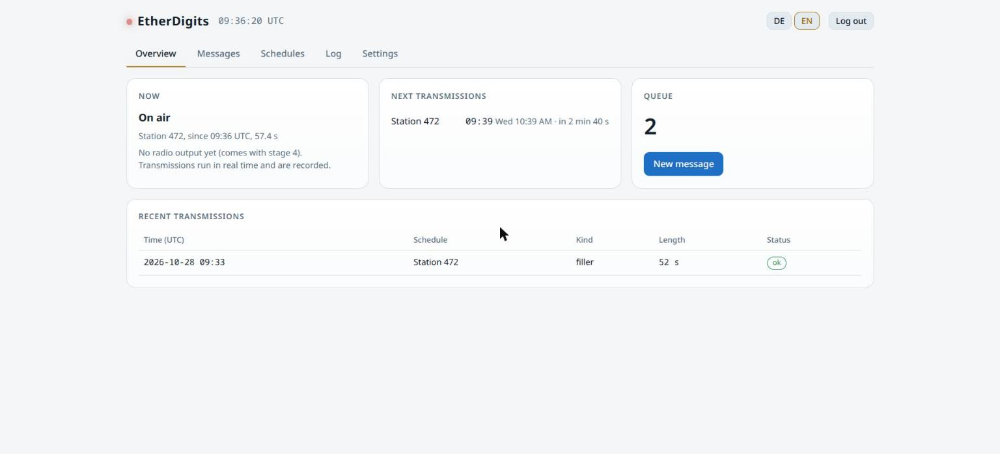

# EtherDigits

<p>
  
  <a href="https://github.com/TechnikWeber/EtherDigits/actions/workflows/tests.yml"></a>
  
  
  <a href="LICENSE"></a>
</p>

**Run your own numbers station.** EtherDigits reads out groups of digits in the
format shortwave numbers stations have used for decades: an interval signal, the
station's callsign, the number of groups, the message, a repeat, and the end.

```
[interval signal]
ATTENTION 472 472 472
GROUPS 3 3
21347 47890 11203
REPEAT 21347 47890 11203
END
```

> Version 0.3: voices, transmission format, the one-time pad tool, and the
> station service with queue, schedules, web interface and API. Radio output
> (sound card, PTT, CAT) follows next; see [docs/plan.md](docs/plan.md).

## Install

Python 3.10 or newer.

```sh
git clone https://github.com/TechnikWeber/EtherDigits.git
cd EtherDigits
python3 -m venv .venv
.venv/bin/pip install -r requirements.txt      # Windows: .venv\Scripts\pip
```

For MP3 output, install `ffmpeg` or `lame`. WAV works without either.

## Use

```sh
python -m etherdigits voices                                   # list voices
python -m etherdigits render -m "21347 47890 11203" -o tx.wav  # German, default voice
python -m etherdigits render --voice en --random 10 --effect radio -o tx.mp3
python -m etherdigits render -o null.wav                       # "no message"
python -m etherdigits render -m "21347 47890"                  # transcript only
```

| Option | What it does |
|---|---|
| `-m GROUPS` | a message; repeat `-m` for several messages in one transmission |
| `--random N` | a test message of N random groups |
| `--voice` | voice id (`de-kerstin`, `de-thorsten`, `en-ljspeech`), language (`de`, `en`) or a folder |
| `--callsign` | station callsign, digits (default `472`) |
| `--repeats` | how often each message is read (default 2) |
| `--interval` | `melody`, `beeps` or `none` |
| `--group-twice` | read every group twice |
| `--pad random\|zero` | fill a short last group instead of failing |
| `--effect radio` | narrow band, a little drive and noise, like AM on shortwave |
| `--format-file` | all format settings from JSON, see [examples/format.json](examples/format.json) |

## Run the station

```sh
python -m etherdigits serve
```

Then open <http://127.0.0.1:8472/>. The station transmits on its schedules
around the clock, fills quiet slots with random groups, logs every
transmission and keeps recordings for a week. Until radio output arrives
(stage 4), transmissions run in real time and are recorded only.



| Tab | What it does |
|---|---|
| Overview | on air or ready, the next transmissions in UTC and local time, the queue |
| Messages | hand in digit groups: priority, number of transmissions, schedule, not before, expiry, delete after sending |
| Schedules | fixed UTC times on chosen weekdays, or every N minutes; voice, callsign, filler, the whole transmission layout; listen to a preview, transmit now |
| Log | every transmission with its transcript and recording |
| Settings | admin password, discreet log, API tokens, pads for encrypting on the station |

**Filler.** When nothing is waiting, a schedule sends random groups that look
exactly like a message, says "no message", or stays silent. Only the first
hides when there is traffic.

**Access.** Without a password only the computer the station runs on can open
the interface. To reach it from elsewhere, set a password and listen on all
addresses; best behind a VPN such as WireGuard or Tailscale:

```sh
python -m etherdigits password
python -m etherdigits serve --host 0.0.0.0
```

**Submitting remotely.** An API token can hand in messages and do nothing else:

```sh
python -m etherdigits token add "Agent North"
curl -X POST http://station:8472/api/submit \
  -H "Authorization: Bearer ed_..." -H "Content-Type: application/json" \
  -d '{"groups": "48213 07460 14476", "priority": 1, "transmissions": 2, "expires_minutes": 1440}'
```

Fields: `groups` (required), `priority` (0 normal, 1 high, 2 urgent),
`transmissions`, `schedule_id`, `not_before` / `expires` (ISO time, UTC) or
`expires_minutes`, `burn` (default true: digits are deleted from the station
after the last transmission).

The data folder holds the database, recordings and pads:
`~/.local/share/etherdigits` on Linux, `%APPDATA%\EtherDigits` on Windows,
`~/Library/Application Support/EtherDigits` on macOS, or `--data DIR`.

## How numbers stations keep messages secret

Not with a lookup table: replacing each letter by a number is broken in minutes
by counting how often each number appears. Numbers stations use a **one-time
pad**:

1. Letters become digits with a *straddling checkerboard*: frequent letters get one
   digit, rare ones two. This table is not secret, it only keeps the message short.
2. A random key of the same length is added digit by digit, without carry:
   `3+8=1`, `7+2=9`. Sender and receiver hold identical pads of key pages.
3. The result is read out in groups of five.

Without the pad page every message of that length is equally likely, so the
transmission cannot be broken, not even in principle. The rules are strict: the
key must be truly random, as long as the message, used once and then destroyed.
Reusing pages is how the Soviet traffic in the VENONA project was read.

The pad tool below is kept apart from the station, so the station itself never
holds keys.

## The pad tool

`pad_tool.html` is a single file that runs in any browser, offline. It makes
pads of key pages, encrypts, decrypts and prints pads and the checkerboard for
pencil-and-paper use. It never touches the network and refuses to use a page
twice.


The same works from the command line, compatible with the browser tool:

```sh
python -m etherdigits pad new -o pad.json --pages 20 --groups 50 --lang de
python -m etherdigits encrypt --pad pad.json "Treffen morgen 18:30 Uhr am Bahnhof"
python -m etherdigits decrypt --pad pad.json "36154 21490 ..."
python -m etherdigits pad info pad.json
python -m etherdigits checkerboard --lang de
```

Sender and receiver need identical copies of the pad. Hand it over in person,
printed or on a USB stick, never over the internet. Save the pad file after
every encryption, so it remembers which pages are used.

**The format.** The first group is the page id, unencrypted, so the receiver
knows which page to take. Then follow the message digits plus the key page,
added without carry. Inside, the text is written with a straddling checkerboard:

| | 0 | 1 | 2 | 3 | 4 | 5 | 6 | 7 | 8 | 9 |
|---|---|---|---|---|---|---|---|---|---|---|
| | E | N | I | S | R | A | T | | | |
| **7** | D | H | U | L | C | G | M | O | B | W |
| **8** | F | K | Z | P | V | J | Y | X | Q | : |
| **9** | space | . | , | ? | - | / | ( | ) | fig | code |

That is the German layout; the English one has E T A O I N S in the top row.
Numbers are written as `98`, every digit twice, `98`. Codebook words as `99`
and a three-digit number. The last group is filled with 9s, which the decoder
ignores. A pad file also carries its language, codebook and the list of used
pages.

## Voices

Three voices come with EtherDigits: two German, one English, all free to share. You can
add your own recordings; see [voices/README.md](voices/README.md).

## Legal

Encrypted or obscured content is not allowed on amateur radio bands. Use an
internet stream, a dummy load, local playback, or a service licensed for it.

## Development

```sh
.venv/bin/python -m unittest
```

`tests/test_interop.py` runs the JavaScript engine from `pad_tool.html` with
Node.js and checks that it agrees with `etherdigits/otp.py` digit for digit.

New voice packs are built from Piper models with `scripts/build_voicepack.py`
(needs `pip install piper-tts`).

## License

[MIT](LICENSE). The voice packs are CC0 or public domain, see [voices/README.md](voices/README.md).
